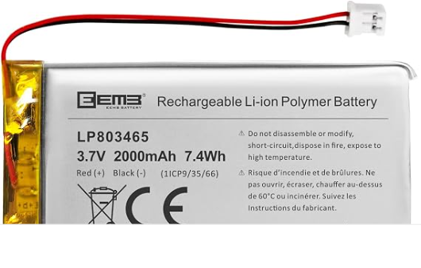

# Battery

The board has a **JST-PH 2.0 mm, 2-pin** battery connector on the back, near the
right-hand edge (next to the ESD sticker), and charges the cell over USB-C.

## Requirements

| Item | Value |
|---|---|
| Chemistry | 1S Li-ion / Li-Po, 3.7 V nominal, 4.2 V full |
| Protection | **Must have a PCM/PCM board on the cell** — the T5 has no protection FETs |
| Connector | JST-PH 2.0 mm (the 1.25 mm type is a different revision and will not fit) |
| Capacity | 1000–2000 mAh fits the back; 2000 mAh is a good compromise |
| Charger | HX6610S, fixed **500 mA**, 4.2 V cutoff, no temperature sensing |

Charging a 2000 mAh pack therefore takes about 4–5 hours from empty.

## Polarity — check before plugging in

Both LilyGo and battery sellers warn that pre-crimped JST-PH plugs are frequently
wired the **opposite way** to the board's footprint. Reversing it can destroy the
charger or the cell.

**There is no usable `+` / `−` silkscreen next to the JST connector on this board**
(the `+` / `−` near the bottom-right of the PCB belong to the 18650 holder
footprint). Measure it instead — it takes about a minute.

### Identify the board's negative pin (unpowered)

1. Unplug USB and any battery.
2. Meter in **continuity / resistance** mode.
3. Clip one probe to a known ground: the **GND pin of a 3-pin header** on the top
   edge (silkscreened `VCC / IOxx / GND`), or the USB-C shell.
4. Touch each of the two JST pins in turn. The pin that reads **≈ 0 Ω / beeps** is
   **negative (GND)**; the other pin is **VBAT positive**.

### Confirm with voltage (optional)

Plug in USB only and put the meter on **DC volts**, probing across the two pins.
Expect roughly **4.1–4.3 V**, with the non-ground pin positive. Some chargers only
regulate once a cell is present, so a 0 V reading does not invalidate the
continuity result.

### Match the battery to it

The pack's leads are almost always **red = +, black = −**, but verify with the
meter. If red lands on the board's ground pin, release the two crimps from the JST
housing with a pin and swap them — never plug it in reversed.

Record the orientation once known (paint pen or nail polish on the housing) so the
check does not have to be repeated.

**Cautions:** never use resistance/continuity mode while USB is connected, and never
connect a JST pack and an 18650 holder at the same time.

## A suitable cell

EEMB **LP803465**, 3.7 V 2000 mAh 7.4 Wh, JST-PHR-02 (2 mm pitch), PCM built in,
about 9.3 × 34.5 × 67 mm (Amazon ASIN `B09DPP44GM`, ~£9). It is 9.3 mm thick, so
the board will not sit perfectly flush with the panel. A 5–7 mm pouch is a flatter
alternative if thickness matters.

## Firmware support

- Voltage is read on **GPIO36** through a nominal **2:1** divider
  (`board::kBatteryDivider`), on ADC1 channel 0.
- The reading appears as a footer meter (percent + bar) on every screen, on the
  Status screen, in `/api/status` (`battery_mv`) and in the web panel (top-bar
  chip + Status card).
- While USB is connected the charger holds the cell node at its ~4.2 V CV
  point, so a percent would lie: above 4210 mV the meter shows **CHG** (full
  bar) instead, above 4260 mV it shows **USB** (no-cell rail, ~4.36 V), and only
  below that a real percent from the 3300–4200 mV curve. There is no
  USB-sense GPIO on this board, so these are voltage inferences, not measured
  charge states.
- On USB with no cell the value floats around the charger rail (~4.36 V); with a
  cell expect 3.7–4.2 V.
- The ADC is uncalibrated. End-to-end calibrated 2026-11-16 against a 4.19 V
  EEMB 2000 mAh cell (`kBatteryDivider = 2.195`). If a multimeter disagrees,
  re-measure and set `divider = measured_cell_mv / pin_mv`.
- This divider is an end-to-end fudge (resistors + uncalibrated ESP32 ADC in
  one number). It is accurate near full; low-end readings may be a few percent
  off until proper `adc_cali` line-fitting lands.
- Deep sleep leaves the panel image in place; the timer wakes on
  `sleep_refresh_min` (default 30 min, settable 5–1440 in the web panel) and any
  user button wakes immediately. On that wake the board fetches fresh data,
  redraws once — the current screen, or the next enabled one when the Power
  card's wake-rotation option is on — and goes back to sleep.
- Wi-Fi modem sleep is disabled (`esp_wifi_set_ps(WIFI_PS_NONE)`): sleeping
  between beacons adds a ~100 ms floor to every reply and causes packet loss with
  APs that buffer unicast poorly. Deep sleep powers the radio off entirely, so
  this costs nothing while the panel is asleep. While awake it costs a few mA.

## Runtime estimate

Sleep current is quoted at ~170 µA for this board. Each wake costs roughly 15–25 s
of Wi-Fi, TLS and a 1.5 s panel refresh, plus a 2.5 s wipe.

| Capacity | 15 min sleep refresh | 5 min sleep refresh |
|---|---|---|
| 1000 mAh | ~2–3 weeks | ~1 week |
| 2000 mAh | ~4–6 weeks | ~2 weeks |

These are estimates from measured wake times, not a lab measurement. The default
30-minute interval sits between the two columns (roughly half the wake cost of
the 15-minute one). The first real battery should be characterised with the
Status screen and a timer.

